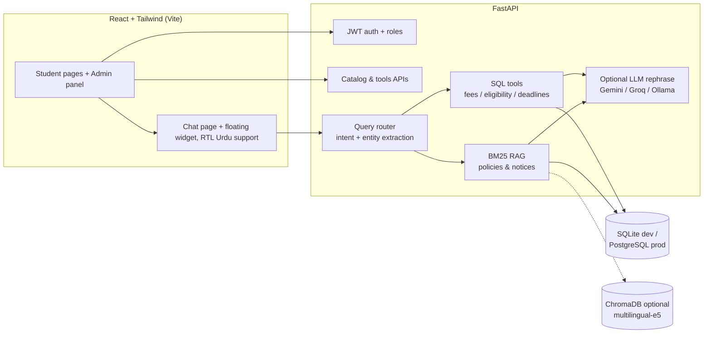

# UniAssist — Multilingual Student Portal with AI Admissions & Fee Chatbot

**Final Year Project — The Islamia University of Bahawalpur (IUB)**

A complete web system where a student can register, browse all IUB faculties,
departments and programs with their **real fees** (Revised Fee Structure,
Fall 2025 — new intake), and ask a chatbot questions in **Urdu script, English,
Roman Urdu or mixed Roman English** — and always get the answer back in the
same language and script.

> **Accuracy rule of this project:** fees, seats, eligibility and deadlines are
> answered from a structured database only — never guessed by an LLM. If data
> is not available, the bot says so honestly and refers the student to the
> official university office. See `docs/PHASE0_ANALYSIS.md` for the full data
> audit (including what the source PDF does **not** contain: minimum marks,
> seats, deadlines and documents are absent from the fee document, so those
> fields stay empty until an admin adds the official admission notice).

---

## 1. What's inside (verified data)

| | |
|---|---|
| Faculties | 14 |
| Departments / institutes / colleges | 104 |
| Programs with real fees | 457 |
| Fee check | Tuition + Other Dues = 1st-semester total holds for 454/457 rows (3 flat-fee diplomas are printed as 0 + 0 ≠ 32,000 in the source and are kept as printed, flagged) |
| Chatbot evaluation | 50 questions + 1 follow-up — intent accuracy **100%**, answer correctness **100%**, language match **98%**, avg latency **~40–70 ms** (local, well under the 5 s target) |
| Unit tests | **29 passed** (auth, router, import) |
| IUB website data (16 Nov 2026) | Official eligibility criteria + merit formula for **175 programs**, 2 Fall 2026 admission deadlines, 3 announcements, 4 policy documents — fetched from iub.edu.pk, see `docs/IUB_WEB_IMPORT.md`. Seats are still not published by any official source, so they remain honestly "not available". |

## 2. Architecture



**Hybrid chatbot:** a deterministic router classifies the question
(fee | eligibility | deadline | comparison | policy | program info |
greeting | out-of-scope), extracts the program (with department-aware
matching for the 181 generically-named M.Phil/PhD rows), and answers from
SQL. Policies/notes go through BM25 retrieval over the official document's
notes. An LLM, *if configured*, only rephrases the verified answer — with no
key configured the system answers with templates and loses nothing factual.
Conversation memory keeps the last turns, so follow-ups like
*"aur us ka deadline?"* resolve to the previously discussed program.

**Multilingual pipeline:** script detection (Nastaliq) → Roman-Urdu lexicon →
synonym normalisation (kitni/kitna → how_much, dakhla → admission,
hy → hai, fees → fee, ai → artificial intelligence…) → Urdu-script program
aliases (کمپیوٹر سائنس → computer science) → answer rendered in the user's
own language/script.

## 3. Quick start

### Option A — Docker (one command)
```bash
cp .env.example .env        # set JWT_SECRET
docker compose up --build
# Frontend: http://localhost:5173   API docs: http://localhost:8000/docs
```

### Option B — Local (SQLite, no Docker)
```bash
# Backend
cd backend
python -m venv .venv && source .venv/bin/activate   # Windows: .venv\Scripts\activate
pip install -r requirements.txt
uvicorn app.main:app --reload --port 8000           # DB auto-seeds on first start

# Frontend (new terminal)
cd frontend
npm install
npm run dev                                          # http://localhost:5173
```

The database seeds itself on first startup from `data/processed/programs.json`
(regenerate from the official PDF with `python backend/scripts/parse_fee_pdf.py`
after running `pdftotext -layout` — see the script header).

## 4. Demo accounts

| Role | Email | Password |
|---|---|---|
| Admin | `admin@iub.edu.pk` | `Admin@123` |
| Student | `student@demo.iub.edu.pk` | `Student@123` |

*Change these in production. In dev mode the forgot-password endpoint returns
the reset token in its response so the flow can be demoed without email.*

## 5. Sample questions (all four language styles)

| Style | Question | Answer (excerpt) |
|---|---|---|
| English | What is the fee of BS Artificial Intelligence? | Group-A: Rs 65,160 first semester… |
| Roman Urdu | BS AI ki fee kitni hai? | Pehla semester Rs 65,160… |
| Urdu script | بی ایس کمپیوٹر سائنس کی فیس کتنی ہے؟ | جواب اردو میں، Rs 65,160… |
| Mixed | I have 80% marks, BS CS mein admission mil jayega? | Level-based eligibility + honest note that programme-wise minimum marks are not in the provided data |
| Follow-up | aur us ka deadline? | Resolves "us" to the last program; honestly reports deadlines are not in the source data |
| Out-of-scope | Cricket match ka score kya hai? | Politely declined — admissions/fees/policies only |

## 6. Features checklist

- **Auth:** register (name, email, phone, city, matric/inter marks, interested
  program), login, JWT access + refresh, forgot/reset password, profile edit,
  bcrypt hashing, role-based admin access, rate limiting, CORS + security headers.
- **Student:** dashboard, searchable/filterable program explorer with fee cards,
  program detail (fee, eligibility, documents, seats — shown only when real data
  exists), fee calculator, side-by-side comparison (up to 4), rule-based
  eligibility checker, announcements, chat history (view/delete), per-answer
  feedback (thumbs up/down + comment), suggested-question chips, voice input
  (Web Speech API), copy answer, English/اردو UI switch with RTL layout,
  dark/light mode.
- **Admin:** CRUD for faculties, departments, programs, fees, requirements,
  deadlines, announcements and policy documents; CSV/XLSX/JSON import with
  preview → confirm and automatic re-indexing; analytics (users, queries/day,
  top & unanswered questions, language distribution, feedback ratio,
  most-viewed programs, avg latency); CSV export of unanswered questions.
- **Chatbot safety:** prompt-injection and off-topic handling, no invented
  fees/dates, source citation + "Please verify with the official office" on
  every factual answer, students can only ever see their own data.

## 7. Tests & evaluation

```bash
pip install pytest httpx
python -m pytest tests/ -q        # 29 unit tests (auth, router, import)
python tests/run_eval.py          # 50-question multilingual evaluation -> tests/eval_report.json
```

Latest measured results (deterministic path, `LLM_PROVIDER=none`):

| Language | n | Intent % | Correct % | Hit@5 % | Avg ms |
|---|---|---|---|---|---|
| English | 15 | 100 | 100 | 93.3 | 44 |
| Roman Urdu | 15 | 100 | 100 | 86.7 | 41 |
| Urdu script | 10 | 100 | 100 | 70.0 | 42 |
| Mixed | 11 | 100 | 100 | 90.9 | 44 |
| **Overall** | **51** | **100** | **100** | **86.3** | **43** |

Hit@5 counts an honest "not available in the data" answer (e.g. hostel,
deadlines in Urdu) as a retrieval miss because it returns no source — by
design those questions *must not* be answered from invented data.

## 8. Project structure

```
uniassist/
├── backend/            FastAPI app (app/api, core, db, nlp, rag, services), Alembic, scripts/
├── frontend/           React + Vite + Tailwind
├── data/
│   ├── raw/            official fee PDF + extracted text
│   └── processed/      programs.json (structured, parser-verified)
├── docs/               PHASE0_ANALYSIS.md, RUN_STEPS_ROMAN_URDU.md
├── tests/              pytest suites + eval_questions.json + run_eval.py
├── assets/             IUB logo + campus photo (as provided)
├── docker-compose.yml
└── .env.example
```

## 9. Configuration (.env)

| Variable | Meaning |
|---|---|
| `DATABASE_URL` | SQLite for dev, PostgreSQL for production |
| `JWT_SECRET` | signing secret — always change in production |
| `LLM_PROVIDER` | `none` (default) \| `gemini` \| `groq` \| `ollama` |
| `LLM_API_KEY`, `LLM_MODEL` | provider credentials/model |
| `CORS_ORIGINS` | comma-separated frontend origins |

## 10. Known limitations & future improvements

- **Source data limits (not code limits):** the fee PDF contains no minimum
  marks, seats, deadlines or document lists. The schema, admin CRUD, import
  and chatbot paths for all of them are built and tested — they activate the
  moment an admin enters the official admission notice data.
- **Group-A/Group-B are undefined in the source PDF**; the UI and chatbot show
  a caveat instead of assuming Morning/Evening.
- Two p.9 special fee slabs (BS Bioinformatics; 9 "underperforming" programs)
  conflict with the main table — both are stored and the conflict is surfaced
  to the student with a verification note rather than silently resolved.
- RAG ships with a dependency-free BM25 engine; ChromaDB + multilingual-e5
  semantic retrieval is wired behind the same interface
  (`requirements-optional.txt`) for heavier corpora.
- The provided logo is a white-background JPG (used in a rounded container and
  as favicon); a transparent PNG from the university would look sharper.
  The campus photo is 540px wide, so it is used behind a navy overlay.
- Password reset emails are stubbed for the demo (dev returns the token);
  connect SMTP for production. LLM rephrasing is optional and off by default.
